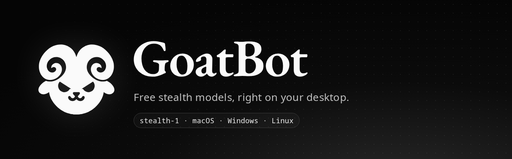

<p align="center"></p>

<p align="center"><a href="README.md">English</a> · <a href="README.zh-CN.md">简体中文</a> · <a href="README.ja.md">日本語</a> · <a href="README.es.md">Español</a> · <b>Français</b> · <a href="README.de.md">Deutsch</a> · <a href="README.pt-BR.md">Português</a> · <a href="README.ru.md">Русский</a> · <a href="README.ko.md">한국어</a></p>

<p align="center"><a href="https://github.com/MovieHolic-Plex/goatbot/releases/latest"></a> <a href="https://github.com/MovieHolic-Plex/goatbot/releases"></a>   <a href="LICENSE"></a></p>

<h3 align="center">Des modèles stealth gratuits, directement sur votre bureau.</h3>

GoatBot est une application de chat de bureau rapide et légère. Elle fonctionne avec **stealth-1** dès l'installation : téléchargez, collez une clé gratuite, discutez. Vous pouvez la brancher sur n'importe quelle autre API compatible OpenAI à tout moment.

<p align="center"><br><sub>Vraie réponse de stealth-1 dans la version Linux</sub></p>

## Fonctionnalités

- **stealth-1 par défaut** : il suffit d'une clé API gratuite
- **Réponses en streaming** avec Markdown, coloration de code, LaTeX et Mermaid
- **Historique local** : conversations et clés restent sur votre appareil
- **Légère et rapide** : coque native Tauri, 6 Mo sous Windows, 13 Mo sous macOS
- **Toute API compatible OpenAI** : changez l'endpoint, la clé et le modèle dans les Réglages
- **Masques de prompt, export Markdown ou image, plus de 20 langues**
- **macOS, Windows et Linux**

## Téléchargement

Tous les fichiers sont sur la page [Releases](https://github.com/MovieHolic-Plex/goatbot/releases/latest). Les builds ne sont pas encore signés.

| Plateforme | Fichier |
|---|---|
| macOS (Apple Silicon + Intel) | [`GoatBot-0.1.0-mac-universal.dmg`](https://github.com/MovieHolic-Plex/goatbot/releases/latest/download/GoatBot-0.1.0-mac-universal.dmg) · [`GoatBot-0.1.0-mac-universal.zip`](https://github.com/MovieHolic-Plex/goatbot/releases/latest/download/GoatBot-0.1.0-mac-universal.zip) |
| Windows 10/11 (x64) | [`GoatBot-0.1.0-win-x64-setup.exe`](https://github.com/MovieHolic-Plex/goatbot/releases/latest/download/GoatBot-0.1.0-win-x64-setup.exe) · [`GoatBot-0.1.0-win-x64.msi`](https://github.com/MovieHolic-Plex/goatbot/releases/latest/download/GoatBot-0.1.0-win-x64.msi) · [`GoatBot-0.1.0-win-x64-portable.zip`](https://github.com/MovieHolic-Plex/goatbot/releases/latest/download/GoatBot-0.1.0-win-x64-portable.zip) |
| Linux (x86_64) | [`GoatBot-0.1.0-linux-x86_64.AppImage`](https://github.com/MovieHolic-Plex/goatbot/releases/latest/download/GoatBot-0.1.0-linux-x86_64.AppImage) |

## Démarrage rapide

1. Téléchargez et installez GoatBot pour votre plateforme.
2. Créez une clé gratuite sur [stealthalpha.dev](https://stealthalpha.dev/signup/).
3. Ouvrez **Réglages** -> **API Key** et collez la clé.
4. Discutez. Le modèle est déjà réglé sur `stealth-1`.

> **Premier lancement d'un build non signé** : macOS, clic droit sur GoatBot.app -> Ouvrir (ou `xattr -dr com.apple.quarantine /Applications/GoatBot.app`). Windows : SmartScreen -> Informations complémentaires -> Exécuter quand même.

## Utiliser une autre API compatible OpenAI

- **Réglages -> API Endpoint** : l'URL de base **sans** `/v1`, par ex. `https://api.example.com` (GoatBot appelle `<endpoint>/v1/chat/completions`).
- **Réglages -> API Key** : la clé de ce service.
- **Réglages -> Modèles personnalisés** : par ex. `-all,+my-model` pour n'afficher que `my-model`, puis choisissez-le dans le sélecteur.

## Compiler depuis les sources

```sh
yarn install
yarn app:build
```

## Crédits et licence

GoatBot est un fork de [NextChat](https://github.com/ChatGPTNextWeb/NextChat), par les contributeurs de NextChat, publié sous licence MIT. La mention de copyright d'origine (`Copyright (c) 2023-2025 NextChat`) est conservée dans [LICENSE](LICENSE) et affichée dans l'application sous **Réglages -> About GoatBot**. Les modifications propres à GoatBot sont publiées sous la même licence MIT.
