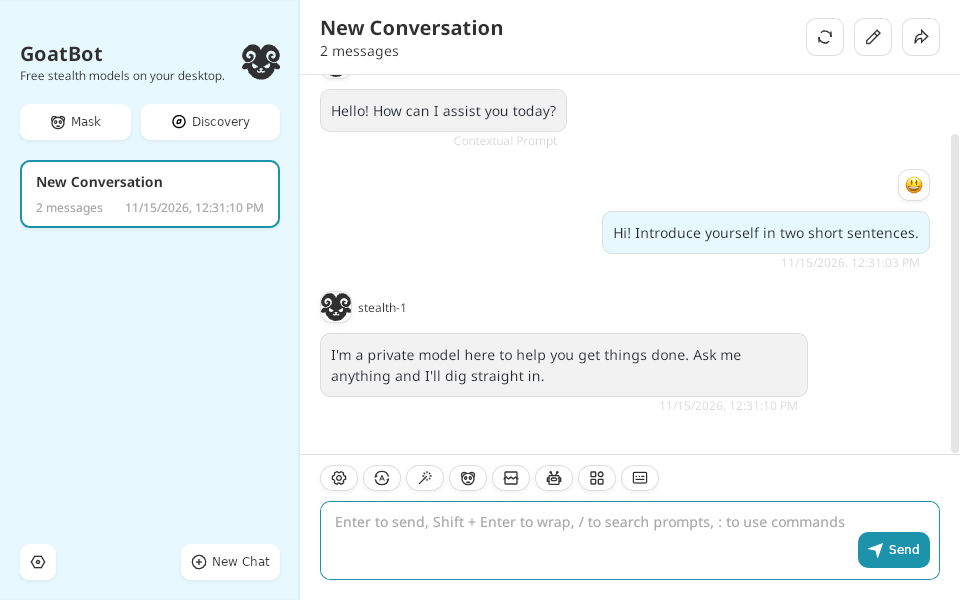

<p align="center"></p>

<p align="center"><a href="README.md">English</a> · <b>简体中文</b> · <a href="README.ja.md">日本語</a> · <a href="README.es.md">Español</a> · <a href="README.fr.md">Français</a> · <a href="README.de.md">Deutsch</a> · <a href="README.pt-BR.md">Português</a> · <a href="README.ru.md">Русский</a> · <a href="README.ko.md">한국어</a></p>

<p align="center"><a href="https://github.com/MovieHolic-Plex/goatbot/releases/latest"></a> <a href="https://github.com/MovieHolic-Plex/goatbot/releases"></a>   <a href="LICENSE"></a></p>

<h3 align="center">免费的 stealth 模型，直接在桌面上使用。</h3>

GoatBot 是一款快速、轻量的桌面聊天应用。开箱即用 **stealth-1**：下载、粘贴免费密钥、开始聊天。也可以随时切换到任何兼容 OpenAI 的 API。

<p align="center"><br><sub>Linux 版本中 stealth-1 的真实回复</sub></p>

## 功能

- **默认使用 stealth-1**：只需一个免费 API 密钥
- **流式回复**，支持 Markdown、代码高亮、LaTeX 和 Mermaid
- **本地历史**：对话和密钥只保存在你的设备上
- **小巧快速**：原生 Tauri 外壳，安装包约 10 MB
- **兼容任何 OpenAI 接口**：在设置中修改地址、密钥和模型
- **提示词面具、导出 Markdown 或图片、20+ 种界面语言**
- **macOS、Windows、Linux**

## 下载

所有文件都在 [Releases](https://github.com/MovieHolic-Plex/goatbot/releases/latest) 页面。目前安装包尚未签名。

| 平台 | 文件 |
|---|---|
| macOS（Apple Silicon + Intel） | [`GoatBot-0.1.0-mac-universal.dmg`](https://github.com/MovieHolic-Plex/goatbot/releases/latest/download/GoatBot-0.1.0-mac-universal.dmg) · [`GoatBot-0.1.0-mac-universal.zip`](https://github.com/MovieHolic-Plex/goatbot/releases/latest/download/GoatBot-0.1.0-mac-universal.zip) |
| Windows 10/11（x64） | [`GoatBot-0.1.0-win-x64-setup.exe`](https://github.com/MovieHolic-Plex/goatbot/releases/latest/download/GoatBot-0.1.0-win-x64-setup.exe) · [`GoatBot-0.1.0-win-x64.msi`](https://github.com/MovieHolic-Plex/goatbot/releases/latest/download/GoatBot-0.1.0-win-x64.msi) · [`GoatBot-0.1.0-win-x64-portable.zip`](https://github.com/MovieHolic-Plex/goatbot/releases/latest/download/GoatBot-0.1.0-win-x64-portable.zip) |
| Linux（x86_64） | [`GoatBot-0.1.0-linux-x86_64.AppImage`](https://github.com/MovieHolic-Plex/goatbot/releases/latest/download/GoatBot-0.1.0-linux-x86_64.AppImage) |

## 快速开始

1. 下载并安装对应平台的 GoatBot。
2. 在 [stealthalpha.dev](https://stealthalpha.dev/signup/) 创建免费密钥。
3. 打开 **设置** -> **API Key**，粘贴密钥。
4. 开始聊天，模型已默认设为 `stealth-1`。

> **未签名版本首次启动**：macOS 右键 GoatBot.app -> 打开（或执行 `xattr -dr com.apple.quarantine /Applications/GoatBot.app`）。Windows：SmartScreen -> 更多信息 -> 仍要运行。

## 使用其他兼容 OpenAI 的 API

- **设置 -> API Endpoint**：基础地址，**不要**带 `/v1`，例如 `https://api.example.com`（GoatBot 请求 `<endpoint>/v1/chat/completions`）。
- **设置 -> API Key**：该服务的密钥。
- **设置 -> 自定义模型**：例如 `-all,+my-model` 只显示 `my-model`，然后在模型选择器中选中。

## 从源码构建

```sh
yarn install
yarn app:build
```

## 致谢与许可

GoatBot 基于 NextChat 贡献者开发的 [NextChat](https://github.com/ChatGPTNextWeb/NextChat)（MIT 许可证）。原版权声明（`Copyright (c) 2023-2025 NextChat`）保留在 [LICENSE](LICENSE) 中，并显示在应用的 **设置 -> About GoatBot**。GoatBot 自身的修改同样以 MIT 许可证发布。
